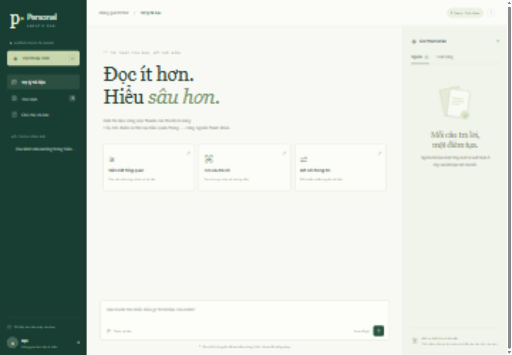
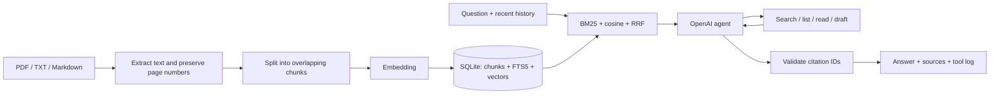

# Personal AgenticRAG

**Your work-document assistant:** upload processes, project documents, and guides;
ask questions in English; verify citations; and save useful answers as notes.




## Quick start on Windows

Requires Python 3.11+ (tested with Python 3.12). In PowerShell:

```powershell
cd D:\Project\AgenticRAG\personal-agentic-rag
python -m venv .venv
.\.venv\Scripts\python.exe -m pip install -r requirements.txt -c requirements-lock.txt
Copy-Item .env.example .env
.\.venv\Scripts\python.exe -m uvicorn app.main:app --host 127.0.0.1 --port 8000
```

If `.venv` already exists and dependencies are installed, run only the last command.
You do not need to activate the virtual environment or change the PowerShell execution policy.
Do not overwrite `.env` if you have already configured it.

Open the [interface](http://127.0.0.1:8000), [API docs](http://127.0.0.1:8000/docs),
or [health check](http://127.0.0.1:8000/api/health).

1. Click **Try sample data** to load three fictional work documents, or upload your own.
2. Ask: “What needs to happen before a software release?” or “What is on the first-week onboarding checklist?”
3. Open a source card to see the original text; PDFs include page numbers. The **Activity** tab records which tools ran.
4. Click **Save note** on an answer to review and save it. The agent does not save notes automatically.

On macOS/Linux, use `python3 -m venv .venv`, `.venv/bin/python` instead of
`.venv\Scripts\python.exe`, and `cp .env.example .env`.

## Demo and OpenAI

| Mode | Retrieval | Answers | Tools |
| --- | --- | --- | --- |
| `demo` (default) | BM25 + keyword hashing vectors | Verbatim excerpts, no LLM synthesis | One fixed retrieval pass |
| `openai` | BM25 + OpenAI embeddings | Model-generated English answers with citations | Search, list, read-more, and draft loop |

Demo requires no key, makes no network calls, and **is not AI agent reasoning**.
It helps test uploads, indexing, sources, history, and the interface.
Questions such as “summarize everything” require OpenAI to select tools and synthesize an answer.

To enable the live AI mode, edit **`.env` in this project directory**:

```dotenv
RAG_PROVIDER=openai
OPENAI_API_KEY=your-key-here
OPENAI_CHAT_MODEL=gpt-4o-mini
OPENAI_EMBED_MODEL=text-embedding-3-small
OWNER_NAME=You
```

Restart the server. You can use a model supported by your account for Chat Completions
and function calling. The adapter calls OpenAI directly through async `httpx`.
The app does not read a parent directory's `.env`; process environment variables take precedence over `.env`.

**Cost and data:** OpenAI charges for embeddings during document ingestion and search;
chat is billed for model requests. When OpenAI is enabled, document text is sent to create
embeddings, and questions, recent conversation history, and retrieved passages are sent for synthesis.
The sample-data button also creates embeddings in OpenAI mode.
Only upload documents you are authorized to send to the model provider.
The API key stays in the backend and does not appear in the interface or conversation history.

Each embedding provider/model uses a **separate SQLite file** in `data/` to prevent mixing
incompatible vectors. When switching from demo to OpenAI or changing the embedding model, re-import your documents.
Documents, conversations, and notes in the previous workspace remain in the previous SQLite file;
restore the old configuration to open them. Changing the chat model does not create a new workspace.

## How it works



- The default chunk size is 900 characters with 150-character overlap; PDF pages are chunked separately to preserve source locations.
- Vietnamese diacritics are normalized for keyword search while the displayed source text remains unchanged.
- BM25 uses SQLite FTS5; cosine similarity uses normalized vectors; results are combined with RRF.
- Demo accepts only keyword matches; OpenAI also accepts vectors with cosine similarity ≥ 0.25.
  This is an initial threshold and should be measured on real documents before relying on it for important decisions.
- The agent always performs a fresh retrieval before answering and can search again/read more up to `MAX_AGENT_STEPS`
  (default 5), with at most 12 additional tool calls. Reaching a limit returns an incomplete status.
- A model turn may call multiple tools; each tool result is paired with its call ID.
- A citation is returned only for a chunk ID that was actually retrieved **and** cited in the answer.
  ID validation does not prove that the source supports the claim; verify the content yourself.
- The activity log records tool operations and does not contain the model's internal reasoning.
- `draft_note` only creates a draft. There are no tools for sending email, scheduling, running shell commands, or reading arbitrary server files.
- Notes do not automatically become indexed documents; import their content as a document to retrieve it later.

## Project structure

```text
personal-agentic-rag/
├── app/
│   ├── main.py          # Lifespan, request limits, static UI
│   ├── api.py           # REST endpoints
│   ├── config.py        # Configuration and workspace namespace
│   ├── database.py      # SQLite, FTS5, history, and notes
│   ├── retrieval.py     # Uploads, PDF, indexing, and hybrid search
│   ├── providers.py     # Offline hashing / async OpenAI
│   ├── agent.py         # Tool registry, loop, and citations
│   ├── schemas.py       # Pydantic validation
│   └── text.py          # Tokenizer and chunking
├── static/              # Plain HTML/CSS/JS interface; no Node required
├── examples/            # Three fictional work documents
├── tests/               # Tests do not call paid APIs
├── .github/workflows/   # CI on Windows/Linux
├── .env.example
├── Dockerfile
├── compose.yaml
├── requirements.txt
├── requirements-dev.txt
└── requirements-lock.txt # Tested versions, used as constraints
```

## API

| Method | Endpoint | Purpose |
| --- | --- | --- |
| GET | `/api/health` | Mode, workspace name, and data counts |
| GET / POST | `/api/documents` | List / add JSON text `{title, content}` |
| POST | `/api/documents/upload` | Multipart upload, `file` field |
| GET / DELETE | `/api/documents/{id}` | Read content / delete document, chunks, and FTS entries |
| POST | `/api/demo/seed` | Load sample data without duplicates |
| GET / POST | `/api/sessions` | List / create a chat `{title?}` |
| GET | `/api/sessions/{id}` | History, sources, and activity |
| POST | `/api/chat` | `{message, session_id?, top_k?}` |
| GET / POST | `/api/notes` | List / save a note `{title, content}` |
| DELETE | `/api/notes/{id}` | Delete a note |

PowerShell example:

```powershell
$question = @{ message = 'What needs to happen before a release?'; top_k = 5 } | ConvertTo-Json
Invoke-RestMethod -Uri http://127.0.0.1:8000/api/chat -Method Post `
  -ContentType 'application/json; charset=utf-8' -Body ([Text.Encoding]::UTF8.GetBytes($question))
```

The response includes `session_id`, `answer`, `citations`, `trace`, `mode`, and `elapsed_ms`.
Send `session_id` with the next question. If omitted, the backend creates a new chat.

## Tests

```powershell
.\.venv\Scripts\python.exe -m pip install -r requirements-dev.txt -c requirements-lock.txt
.\.venv\Scripts\python.exe -m pytest
```

Tests use temporary directories and exercise the real pipeline (upload → indexing → search → citations →
session persistence), PDF page numbers, duplicate uploads, index deletion, session isolation, input limits,
the tool-calling loop, and the OpenAI adapter with mocked HTTP. No real API key is used.

## Docker

```powershell
Copy-Item .env.example .env # Only if .env does not already exist
docker compose up --build -d
docker compose logs -f
docker compose down
```

Open `http://127.0.0.1:8000`. The `rag-data` volume preserves data when the container is recreated.
`docker compose down` keeps the volume; do not use `down -v` if you need the data.
